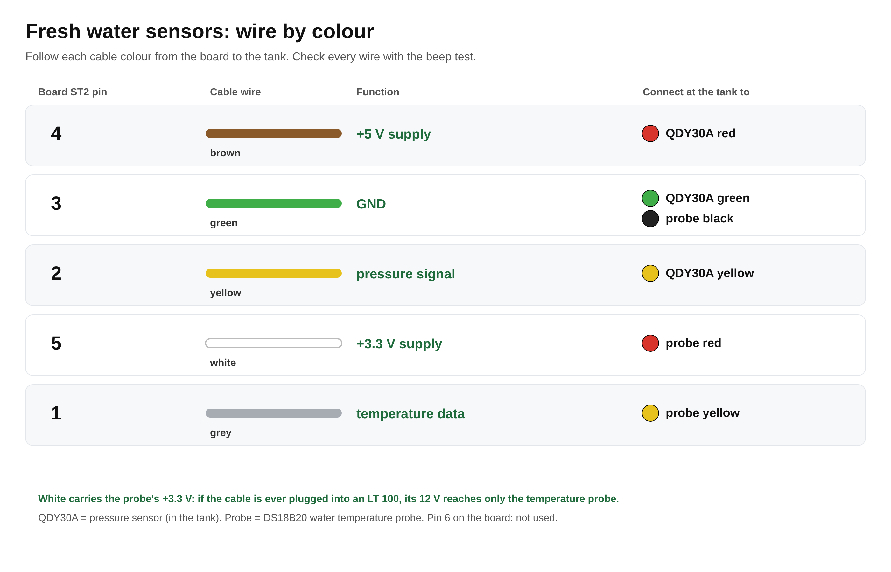
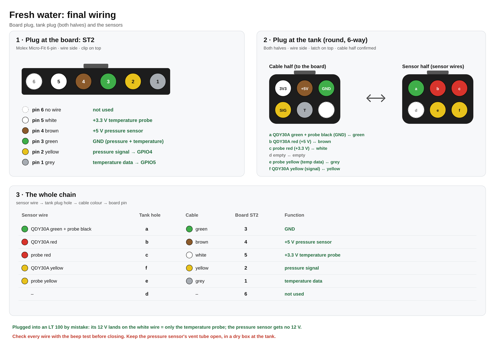

# Fresh water sensors: wiring guide

How to connect the **pressure sensor** (QDY30A, measures the water level) and the **water
temperature probe** (DS18B20) to the old fresh water cable, the 5-wire cable that ran from the
tank to the LT 100.

**The rule that makes it simple: wire by colour, not by position.** Each wire keeps its colour
from the board end to the tank. Hole positions in the plugs (mirrored or not) don't matter,
because you check every wire with a beep test before you close anything.



| Cable wire | Function | At the tank, connect to | At the board (ST2 pin) |
|---|---|---|---|
| **brown** | +5 V supply | QDY30A **red** | 4 |
| **green** | GND | QDY30A **green** + probe **black** | 3 |
| **yellow** | pressure signal | QDY30A **yellow** | 2 |
| **white** | +3.3 V supply | probe **red** | 5 |
| **grey** | temperature data | probe **yellow** | 1 |
| – | – | – | 6 (not used) |

Easy to remember: **green goes to green and yellow to yellow** for the pressure sensor (ground and
signal), brown is its +5 V; the temperature probe gets the light colours, white (+3.3 V) and grey
(data).

**Why white is the probe's +3.3 V:** the LT 100 puts 12 V on the white wire. If this cable is
ever plugged back into an LT 100 by mistake, the 12 V reaches only the temperature probe (cheap,
may break), never the pressure sensor; the LT 100's other four wires are measuring inputs without
supply.

## What you need

* Multimeter with a beep (continuity) setting
* A small dry junction box at the tank (IP54 or better) with 2 cable glands, and one with a
  breathing vent or simply the glands facing down
* 4 small connectors (WAGO 221 lever connectors are ideal) or solder + heat-shrink
* 1 resistor 4.7 kΩ (temperature probe pull-up, only needed until the new board exists, see the end)

## Step 1 – Free the cable (12 V not needed)

1. Switch the 12 V system off.
2. At the LT 100: unplug the 6-pin fresh water plug (ST2). It stays unplugged from now on.
3. At the tank: open the round 6-way plug and **cut the rod sender off** behind its half of the
   plug, or pull its wires out of the plug. You keep the cable half (with brown, white, yellow,
   green, grey) and, if you like, the other plug half as a socket for the sensors.

   *Keeping the round plug:* re-pin its **sensor half** (the half that held the rod sender) with
   the sensor wires. Seen from the wire side with the latch on top, the **cable half** is
   (confirmed): top row white · brown · green, bottom row yellow · grey · empty. The sensor half
   is its mirror image:

   

   | Sensor half hole (wire side, latch on top) | Sensor wire | Meets cable wire |
   |---|---|---|
   | a top left | QDY30A green + probe black | green |
   | b top middle | QDY30A red | brown |
   | c top right | probe red | white |
   | d bottom left | – (empty) | – |
   | e bottom middle | probe yellow | grey |
   | f bottom right | QDY30A yellow | yellow |

   Two wires in one contact (hole a) rarely hold well: join QDY30A green and probe black to a
   short single wire first (solder or a small splice) and crimp that one.

   *Easiest:* don't re-pin the round plug at all. Cut the cable just before the round plug,
   strip the 5 wires and bring them into the junction box. You then work with plain coloured
   wires and nothing can end up mirrored.

## Step 2 – Beep test: make sure the colours match end to end

Do this once, before connecting the sensors:

1. Multimeter on **beep** (continuity).
2. At the board end (the ST2 plug), put one probe on the contact of the **brown** wire (push a
   thin needle in from the wire side if needed).
3. At the tank end, touch the other probe to each of the 5 wire ends: it beeps on exactly one.
   That one must be **brown** too.
4. Repeat for green, yellow, white and grey.
5. If a colour changes along the way (for example inside the round plug), write it down and use
   the colour **at the tank** for step 3, but keep the function from the table above.

## Step 3 – Connect the sensors in the junction box

```
 cable brown  ───────────── QDY30A red      (+5 V)
 cable green  ──────┬────── QDY30A green    (GND)
                    └────── probe black     (GND)
 cable yellow ───────────── QDY30A yellow   (pressure signal)
 cable white  ───────────── probe red       (+3.3 V)
 cable grey   ───────────── probe yellow    (temperature data)
```

* **Ground (green):** three wires in one connector: cable green + QDY30A green + probe black.
  With a WAGO 221-413 (3-way) that's one lever; when soldering, twist them, solder, heat-shrink.
* **Vent tube:** the QDY30A cable has a thin air tube inside. Its end must stay **open, in dry
  air**: cut the cable straight, don't fill it with glue or heat-shrink, and keep the end inside
  the box. If the tube is closed or gets wet, the reading drifts.
* Mount the box higher than the tank's top if you can, cable glands facing down, so no water
  can run into it.

## Step 4 – Check before power

With the multimeter on **resistance**, at the board end (ST2 plug):

| Measure between | Expect | If not |
|---|---|---|
| brown and green | not a short (some kΩ or more) | +5 V and ground swapped or touching: fix before power! |
| white and green | not a short | probe wires swapped or touching |
| yellow and green | not a short | |
| grey and green | not a short | |

Then, with the **new board** (or the test setup below) powered, measure with the meter on
**DC volts**, black probe on green:

| Wire | Expect |
|---|---|
| brown | about 5.0 V |
| white | about 3.3 V |
| yellow | about 0 V with the tank empty, rising about 0.165 V per 10 cm of water |
| grey | about 3.3 V (pulled up; the probe pulls it down briefly when it talks) |

## Step 5 – In Venus OS and the mods page

* The water level comes from the pressure sensor; run `zero` once with the **empty** tank
  (Water tab → Settings, or the sensor's own page), see [calibration.md](calibration.md).
* The water temperature appears as temperature 1 ("Inside" by default; rename it to "Water").

## Until the new board exists (test with the current I/O extension)

The new board (see [io-board.md](io-board.md)) has the ST2 socket and all resistors on it. To use
the cable now with the current hand-wired ESP32, connect its board end like this (see
[wiring.md](wiring.md), option C, for the pressure input):

| Cable wire | Current I/O extension |
|---|---|
| brown | buck converter **5 V output, before the diode** |
| green | GND |
| yellow | 10 kΩ → GPIO4, with 100 nF and 1 MΩ from GPIO4 to GND |
| white | ESP32 **3V3** |
| grey | GPIO5, with **4.7 kΩ** from GPIO5 to 3V3 |

The cable can be several metres long; that is fine for both sensors (for very long runs use
2.2 kΩ instead of 4.7 kΩ on the temperature data line).
