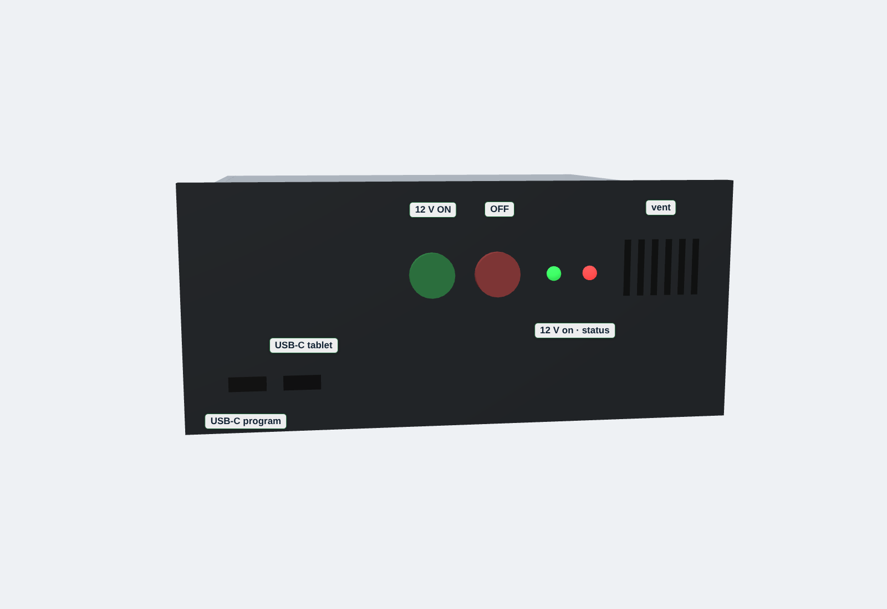

# I/O board: schematic, parts and design review

Planning schematic for the board in [io-board.md](io-board.md), drawn sheet by sheet with every
part and value. It is the base for the KiCad schematic and layout, not yet a manufacturing file.

**KiCad project:** [hardware/io-board](../hardware/io-board/README.md) (schematic, placed board,
parts list).

## 3D view

| Board | Casing, lid off | Casing closed (front plate) |
|---|---|---|
|  |  |  |

The casing slides through the LT 100 opening; the front plate (135 × 60 mm) closes it and carries
the USB-C tablet socket, the 12 V ON and OFF buttons, the "12 V on" and status LEDs and the vent slots for the
humidity sensor. The programming USB-C sits behind the plate.

## Schematic sheets

1. [Power](io-board/schematic/sheet1.png): ST1 and 12 V AUX in, OR-ing, TVS, 12→5 V module, 3.3 V LDO, battery voltage
2. [ESP32-S3](io-board/schematic/sheet2.png): module, USB-C programming, reset/boot, all pin assignments
3. [EBL 119 and front plate](io-board/schematic/sheet3.png): ON/OFF photoMOS, "12 V on" and mains inputs, front LED and button
4. [Tanks](io-board/schematic/sheet4.png): ST2 fresh water (pressure sensor + probe), ST3 grey rods
5. [Outputs 1 and 2](io-board/schematic/sheet5.png): relays with current sense
6. [Truma, CP plus 12 V, inputs](io-board/schematic/sheet6.png): LIN transceiver, RJ12 in/out, fused 12 V for the CP plus, 3 inputs
7. [USB PD, sensors, expansion](io-board/schematic/sheet7.png): 30 W tablet charging, tilt + humidity, RJ45 expansion

## Main parts

| Ref | Part | What for |
|---|---|---|
| U3 | ESP32-S3-WROOM-1-N8 | controller, Wi-Fi, Bluetooth |
| U1 | Traco TSR 1-2450 | 12 → 5 V, 1 A |
| U2 | AP7361C-33E | 5 → 3.3 V, 1 A |
| D1, D2 | SS34 | supply OR-ing, reverse polarity |
| D4 | SMBJ24A | 12 V transient clamp |
| F1 / F2 | 0.5 A PTC / 10 A blade fuse | ST1 supply / 12 V AUX |
| U5, U6 | AQY212EH photoMOS | EBL ON / OFF pulses from the ESP32 |
| SW3, SW4 | front push buttons | EBL ON / OFF by hand (direct) |
| U7, U8, U70–U72 | PC817 | "12 V on", mains, inputs 1–3 |
| K1, K2 | 12 V relay, changeover, 5 A (e.g. Song Chuan 833H-1C-C) | Output 1, Output 2 |
| Q1, Q2 | AO3400 | relay drivers |
| U11, U21 | INA180A3 + LMV331 | output current sense ("output on") |
| F4, F5 | 5 A fuse | Output 1, Output 2 |
| U60 | TJA1021T/20 | Truma LIN bus |
| D60 | PESD1LIN | LIN ESD protection |
| F6 | 1 A PTC | 12 V for the CP plus |
| U80 | SW3516H (+ reference parts) | USB-C PD 30 W |
| Q80, Q81 | AO3401, 2N7002 | USB PD on/off |
| U90 | LIS2DW12 | tilt |
| U91 | SHT40 | humidity + temperature |
| U92 | PCA9615 | differential I²C to the RJ45 |
| U4 | USBLC6-2SC6 | USB ESD |
| J | Molex Micro-Fit 3.0: 43045-0600 (ST1, 2 rows), 43650-0600 (ST2), 43650-0500 (ST3); 2 × RJ12 6P6C; RJ45; 2 × USB-C; push-in terminals 5.08 mm (power) and 3.5 mm (inputs) | connectors |

## Design review

Checked against the van measurements, the LT 100 / EBL manuals and the Truma community
projects. What is right, what to check, and what I recommend changing.

**Checked and correct**

* ST1 (EBL) colours, functions and plug position: measured in the van and matching the LT 100
  manual (6-5-4 over 3-2-1, wire side, clip on top).
* ST2 (fresh water): white carries the probe's 3.3 V, so a wrong plug into an LT 100 (12 V on
  white) never reaches the pressure sensor; the tank plug cable half is confirmed.
* The board can't be powered backwards (D1/D2), transients are clamped (D4), every cable input
  has a series resistor and ESD protection.
* Heavy loads only on 12 V AUX (EBL Spare 4), so the LT 100's old battery sense line (ST1 blue)
  only feeds the electronics and stays an accurate voltage measurement.

**Truma LIN: to check before the layout**

* RJ12 **pin 3 = LIN, pin 5 = GND** comes from the inetbox.py project (Combi 4 + CP plus), not
  from Truma. Check with a meter: pin 3 idles near 12 V and flickers when the CP plus polls,
  pin 5 is 0 V to the van ground.
* **Use a 1:1 RJ12 cable.** Telephone-style RJ12 cables are often crossed: pin 3 then arrives on
  pin 4 and the board hears nothing. Simplest: use Truma's own TIN cable, or check with the meter
  at the board's socket.
* The CP plus must be "iNet ready" (the label on yours says it is).
* The board is a LIN **slave** (like the iNet box): no 1 kΩ master pull-up, the CP plus stays the
  master. That is how it is drawn.
* The CP plus has its **own 12 V supply** (red and red/black wires on its back), separate from
  the bus: the new fused **CP plus 12 V** terminal feeds it from Spare 4, so heating, frost guard
  and timer keep working with the EBL main switch off.

**Decisions**

1. **12 V on/off without the ESP32: done.** Two front buttons (ON, OFF) wired straight to ST1
   green and yellow, like the LT 100's (sheet 3). The ESP32 still switches the EBL itself through
   the photoMOS outputs and sees every change on the "12 V on" wire.
2. **Relays: normal (non-latching), decided.** They drop for a moment when the ESP32 restarts.
3. **EBL Spare 4 fuse: to check in the van.** 12 V AUX can draw up to about 10 A (both outputs,
   30 W charging, CP plus, expansion); the board's F2 is 10 A.
4. **Grey water sensor:** a passive 5-rod probe on about 5 m of cable. Its wire colours from the
   datasheet are uncertain (two of ge/gr): find the common and each level with the beep test.
   The rod inputs use 10 kΩ series, 100 nF and 100 kΩ pull-down (sheet 4) for the long cable.
5. **RJ45 stays**, labelled "EXPANSION – NOT ETHERNET" on the casing.

**Next steps**

* Measure the Truma RJ12 (pin 3 and 5) and decide on points 1–5.
* Then the schematic goes into KiCad, followed by the layout, a design check, and one prototype.
