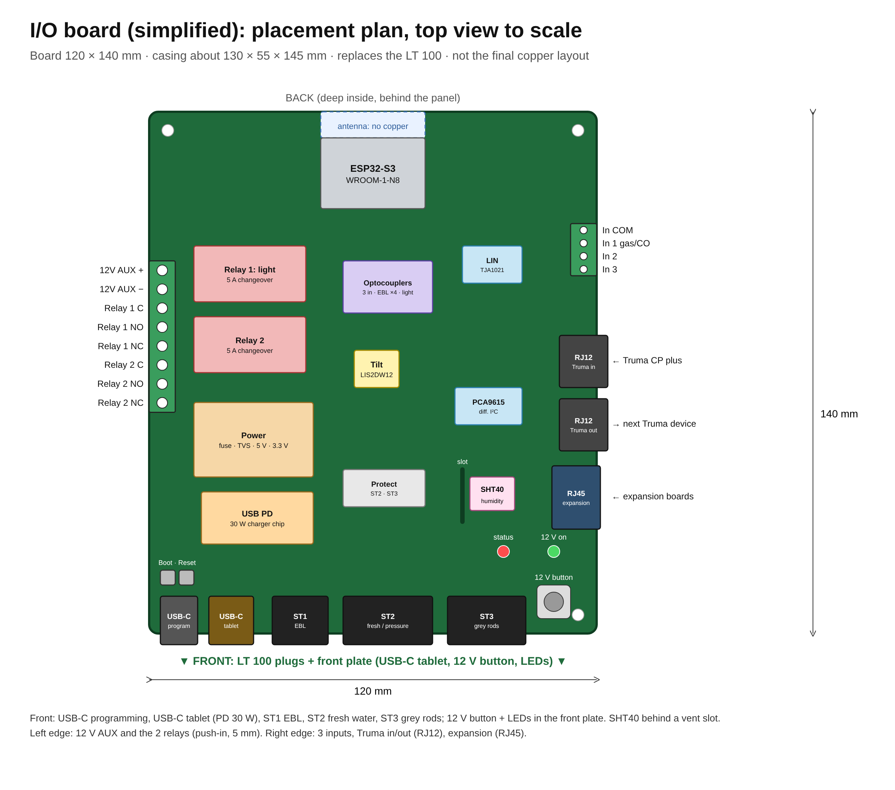

# I/O board: specification (planning)

One printed circuit board that **replaces the LT 100 panel** and the hand-wired I/O extension
(ESP32-S3 dev board, buck converter, resistors). It switches the EBL 119, reads the fresh and grey
tanks, talks to the Truma CP plus, charges a tablet, and has 3 inputs, 2 outputs and a tilt
sensor; more I/O comes later on expansion boards over RJ45. Status: **planning**; the van wiring is
measured, the schematic is next.

## Overview

| Block | What | Connection |
|---|---|---|
| ESP32-S3 | Module **ESP32-S3-WROOM-1-N8** (antenna on the module; plastic casing in the living area) | – |
| Power | From the EBL cable (ST1 blue + / brown −) for the electronics; **12 V AUX** for the outputs and the USB charging socket; two diodes pick the input with power | ST1 + push-in |
| **LT 100: EBL 119 on/off** | Short pulse to ground on ON (green) or OFF (yellow); reads "12 V on" (white) and mains (pink); battery voltage from the blue wire | **ST1**: Micro-Fit 6-pin, 2 rows |
| **LT 100: fresh water** | The existing fresh water cable, now connected to the **pressure sensor** (QDY30A 0–3.3 V) and the water temperature probe at the tank | **ST2**: Micro-Fit 6-pin, 1 row |
| **LT 100: grey water** | Rod sender, common + 4 rods | **ST3**: Micro-Fit 5-pin, 1 row |
| 12 V button + LED | Push button on the front plate: 12 V system on/off, also without Wi-Fi or the tablet; green LED driven straight by the "12 V on" wire | front plate |
| Truma CP plus | LIN bus (TJA1021), **in and out**: two RJ12 sockets in parallel, so the board sits in the Truma cable chain | 2 × RJ12 |
| USB-C programming | Flashing and serial log (ESP32 native USB), Boot and Reset buttons | USB-C |
| USB-C tablet | Charging socket on the front plate, **USB PD up to 30 W** (PD charger chip, e.g. SW3516 or IP6557, from 12 V AUX), plain 5 V for devices without PD; the board can switch it off | USB-C, front plate |
| 3 inputs | Isolated (optocoupler), 5–30 V; jumper per input: "12 V = on" or "contact to ground = on"; what each input means is set later in the settings | push-in |
| 2 outputs, 5 A | Relays with changeover contact (C / NO / NC), 5 A at 14 V DC, LED each. **Output 1 = light** (two-way with the wall switch, with "light on" sense), output 2 free | push-in |
| Tilt | Accelerometer LIS2DW12: levelling, water tank slope correction, movement | on the board |
| Humidity + temperature | **SHT40** on the board (I²C), in the front plate area behind a vent slot, cut off from the warm parts by a slot in the board; replaces temperature probe 2 | on the board |
| **Expansion (RJ45)** | 12 V, ground and I²C for expansion boards (more inputs/outputs later), I²C as a differential pair (PCA9615) so the cable can be several metres | RJ45 |
| Status | RGB status LED (front plate) | – |
| Removed (simplified) | CAN, MOSFET outputs, analog inputs, 8 inputs → 3, display power out, spare header, I/O expander and ADC chips, separate PRESSURE socket, temperature probe 2 | – |

## Size and casing

The board sits **in place of the LT 100**: its casing slides in flat through the LT 100 opening
and lies in the space behind the panel; its front plate closes the opening and carries the 12 V
button and LED, the USB-C tablet socket and the status LED.

| | Size |
|---|---|
| LT 100 opening in the panel (measured from photos) | about 135 × 60 mm |
| Depth behind the panel (measured) | at least 150 mm |
| Casing outside | about **130 × 55 × 145 mm** |
| Board | **120 × 140 mm**, parts up to about 40 mm high |



* Casing: plastic (Wi-Fi and Bluetooth), 3D-printed to fit the board: bottom tray with screw
  posts, a lid, the front plate, openings for the plugs.
* Fixed with two screws at the back or a flat bracket, so it can't move (the tilt sensor needs it).
* The LT 100 plugs (ST1, ST2, ST3) and the programming USB-C are on the front edge, right behind
  the front plate. Truma, expansion and the push-in terminals are on the side edges: slide the
  casing out to reach them, so leave about 20 cm of slack in those cables.

## ST1: EBL 119 cable (was to the LT 100) – measured


| Pin* | Wire | Function | Idle / off | Active / on | On the board |
|---|---|---|---|---|---|
| 6 | blue | +12 V permanent | 12 V | 12 V | supply + and battery voltage |
| 4 | brown | ground | 0 V | 0 V | supply − |
| 2 | green | ON button | 12 V | pulled to 0 V | pulse to ground |
| 1 | yellow | OFF button | 12 V | pulled to 0 V | pulse to ground |
| 3 | white | "12 V on" indicator | ≈ 2 V | 12 V | input, threshold ≈ 6 V; also the front LED |
| 5 | pink | mains (230 V) indicator | 0 V | ≈ 8 V | input, threshold ≈ 4 V |

\* Pin numbers from the LT 100 wiring diagram; colours and functions are measured in the van.
Check the moulded pin-1 mark on the plug.

* The EBL needs a panel on ST1 to work; that is now the board.
* ON/OFF: optocoupler outputs to ground, pulse about 300 ms; the white wire confirms.
* The blue/brown lines have a 2.5 A self-resetting fuse in the EBL: they feed only the electronics
  (≈ 50 mA) and the voltage measurement. The relays and the USB charging socket use **12 V AUX**
  (EBL "Spare 4", unswitched, or the battery with its own fuse).
* EBL notes (manual 811.0421): heater, frost valve, fridge, step light and Spare 4 stay on when the
  main switch is off; below 10.5 V everything except the frost valve is cut.

## ST2: fresh water cable → pressure sensor

The existing fresh water cable (it went from the rod sender to the LT 100) is reused: at the
tank its wires are connected to the pressure sensor and the water temperature probe instead of
the rods; at the board it plugs into ST2. The board decides what each pin carries, so the white
wire (the LT 100's 12 V for the rods) now carries the sensor supply.


| Pin* | Wire | Was (rods, LT 100) | Now (board) | Sensor / probe wire |
|---|---|---|---|---|
| 5 | white | Base, +12 V | **+5 V sensor supply** | QDY30A red (V+) |
| 4 | brown | ¼ rod | **GND pressure sensor** | QDY30A green (V−) |
| 3 | green | ½ rod | **pressure signal** (10 kΩ + RC to GPIO4) | QDY30A yellow (out) |
| 2 | yellow | ¾ rod | **water temperature data** (DS18B20, 4.7 kΩ to 3.3 V) | probe yellow (data) |
| 1 | grey | Full rod | **+3.3 V** for the temperature probe | probe red (VDD) |
| 6 | – (new wire) | not connected | **GND temperature probe** | probe black (GND) |

\* Pin numbers as on the LT 100's ST2 (grey 1 … white 5); confirm the pin-1 mark.

* Pin 6 was empty in the LT 100 cable, so the cable has only 5 wires: add a 6th wire (and a
  Micro-Fit crimp contact) for the probe's ground. Both grounds are joined on the board; a
  separate wire keeps the probe's return current off the pressure signal's ground.
* **5 V, not 12 V**, on the white wire: the 0–3.3 V version of the QDY30A runs on 5 V (see
  [wiring.md](wiring.md)). Do not plug this cable back into an LT 100 afterwards.
* The pressure sensor's vent tube needs open air: make the joint at the tank in a small dry box
  (see the note on extending the sensor cable in [wiring.md](wiring.md)).
* The fresh tank is then measured in litres (pressure sensor); the 4-step rod reading is no longer
  used.

## ST3: grey water rods

Micro-Fit 5-pin, same plug as the LT 100's grey socket. The board drives the common rod with short
pulses (no constant voltage, so the rods don't corrode) and reads the four rods, see
[wiring.md](wiring.md#grey-water-tank-rod-sender-5-wire-plug).

## Truma CP plus (LIN)

Two RJ12 sockets wired in parallel (pins straight through), like the CP plus's own sockets: one
cable from the CP plus in, the other out to the next device if there is one. The TJA1021
transceiver listens and answers like an iNet box (see [truma.md](truma.md)).

## Outputs: 2 relays, 5 A

**Output 1: light.** The wall switch keeps working, also when the board is off: the relay and the
switch form a two-way (stairway) circuit.

```
 +12 V (fused) ──── wall switch C
                   (ON-ON changeover)
                     A ─────────── relay 1 NO
                     B ─────────── relay 1 NC
                                   relay 1 C ──── lamp + ──── lamp − ── GND
                                           │
                                           └── "light on" sense (optocoupler)
```

* The round on/off rocker is replaced by a round **ON-ON changeover rocker** of the same size
  (3 tabs); one more wire to the board.
* The "light on" sense tells the board whether the lamp is really on (the wall switch may have
  changed it).

**Output 2: free**, changeover contact on push-in terminals (C / NO / NC), 5 A.

## Inputs (3)

| Input | Use | Signal |
|---|---|---|
| 1 | Gas/CO alarm Karman 3Gas+ (white wire "Alarm out") | **12 V on alarm** (measured) |
| 2 | free, general on/off contact | either, by jumper |
| 3 | free, general on/off contact | either, by jumper |

Inputs 2 and 3 are plain on/off contacts: what they mean (name, alarm or just a status, active
high or low) is set later on the mods page, without changing the board. Examples: a smoke
detector with an alarm contact, ignition / D+, door, step out.

Mains present and "12 V on" come from ST1 and don't use these inputs.

## Expansion (RJ45)

For later boards with more inputs and outputs (they plug in with a normal network cable;
**not** Ethernet, don't plug it into a router).

| RJ45 pin | Signal |
|---|---|
| 1, 2 | +12 V (from 12 V AUX, fused 1 A) |
| 3 / 6 | I²C data + / − (PCA9615, differential) |
| 4 / 5 | I²C clock + / − |
| 7 | interrupt (open drain, shared with the tilt sensor) |
| 8 | GND |

## Pin plan (ESP32-S3)

All functions fit on the ESP32's own pins; no I/O expander or ADC chip.

| Function | GPIO |
|---|---|
| Pressure sensor (ST2 green) | 4 |
| Temperature probe (water, ST2 yellow) | 5 |
| Grey rods ST3: common / rods (lowest first) | 9 / 1, 2, 7, 8 |
| Leisure battery voltage (ST1 blue, divider) | 10 |
| I²C (tilt sensor, expansion) | 15, 16 |
| Interrupt (tilt sensor, expansion) | 47 |
| Truma LIN RX / TX / SLP | 17 / 18 / 21 |
| Relay 1 (light) / relay 2 | 38 / 39 |
| "Light on" sense | 14 |
| Inputs 1 / 2 / 3 | 11 / 12 / 13 |
| EBL ON / OFF pulse | 35 / 36 |
| EBL "12 V on" / mains | 37 / 42 |
| 12 V button | 40 |
| USB tablet socket on/off | 41 |
| RGB status LED | 48 |
| USB-C programming | 19, 20 |
| Free | 6 |
| Kept free | 0, 3, 45, 46 (strapping) |

I²C addresses: LIS2DW12 0x18, SHT40 0x44; expansion boards use other addresses.

## Protection

* 12 V inputs: fuse (polyfuse), reverse-polarity protection, TVS diode (van transients).
* Sensor, rod and probe lines: series resistors and ESD protection.
* Relay coils: flyback diodes.
* Power use about 0.5 W idle (≈ 1 Ah/day from the leisure battery); each relay adds about
  0.4 W while on; a charging tablet up to 30 W.

## Firmware and pages (after the board)

* EBL: "12 V system" switch in Venus OS, on the mods page and on the tablet; mains present as a
  status; battery voltage.
* Tanks: fresh water in litres (pressure sensor), grey water from the rods.
* Inputs: gas/CO as a Venus OS alarm and notification; inputs 2 and 3 named and configured on the mods page (status, alarm or switch).
* Outputs: light and output 2 as switches in Venus OS (switch pane) and on the tablet.
* Humidity and temperature in the living area: Venus OS temperature service (with humidity), condensation warning.
* Tilt: levelling page (pitch, roll, how much to raise which wheel), water volume corrected for
  slope, "set level" calibration, movement alarm.

## Still open

* Confirm the pin-1 marks of ST1 and ST2.
* Schematic, parts list with order numbers, layout (KiCad), then one prototype before more.
