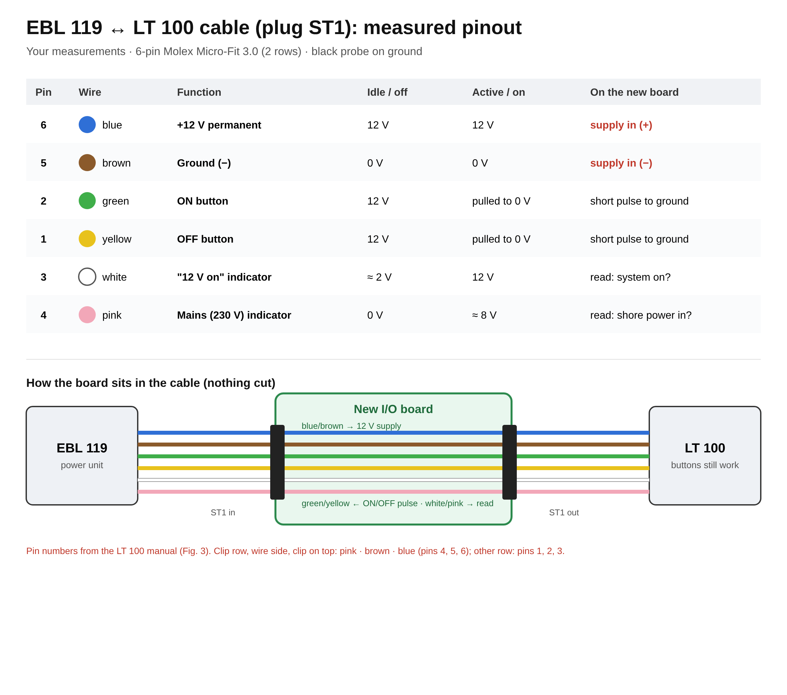
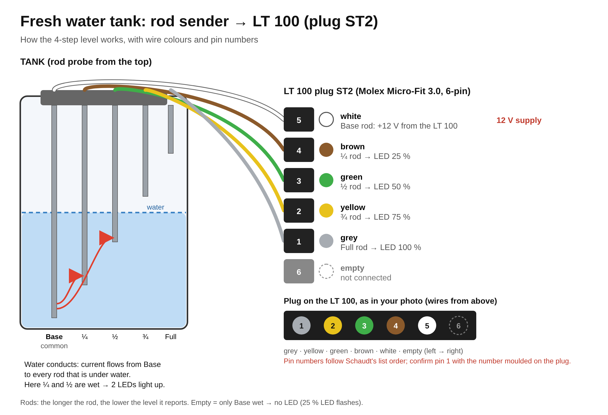

# I/O board: specification (planning)

One printed circuit board that replaces the hand-wired I/O extension (ESP32-S3 dev board,
buck converter, resistors). It reads the tanks, talks to the Truma CP plus, switches the
EBL 119 on and off, and has relays, inputs and a tilt sensor. Status: **planning**, all
connections below are agreed and the van wiring is measured; the schematic is next.

## Overview

| Block | What | Connection |
|---|---|---|
| ESP32-S3 | Module **ESP32-S3-WROOM-1-N8** (antenna on the module; the box sits in the living area, plastic surroundings) | – |
| Power | From the EBL ↔ LT 100 cable (ST1, blue + / brown −), optional second input **12 V AUX** for relays, outputs and display; two diodes pick the input with power | ST1 + push-in |
| EBL 119 on/off | Pass-through on ST1: short pulse to ground on ON (green) or OFF (yellow); reads "12 V on" (white) and mains (pink) | 2 × Micro-Fit 6-pin, 2 rows |
| Fresh water | Pressure sensor QDY30A 0–3.3 V + water temperature probe | Micro-Fit 6-pin, 1 row, label **PRESSURE** |
| Grey water | Rod sender (common + 4 rods), same plug as on the LT 100 | Micro-Fit 5-pin, 1 row |
| Truma CP plus | LIN bus, TJA1021 transceiver | RJ12 |
| 4 relays | 10 A at 14 V DC, changeover contacts (C / NO / NC), LED each | push-in, ≥ 10 A |
| 4 silent outputs | Low-side MOSFET, on/off, about 5 A, flyback diode, LED each | push-in |
| 8 inputs | Isolated (optocoupler), 5–30 V; jumper per input: "12 V on alarm" or "switches to ground" | push-in |
| 2 analog inputs | Jumper per input: 0–10 V, 4–20 mA, or resistive sender (0–190 Ω / 240–33 Ω, e.g. a second tank or a fuel sender); 16-bit (ADS1115) | push-in |
| Battery voltage | Precise measurement of the leisure battery (ST1 blue) and of 12 V AUX (ADS1115) | – |
| CAN bus | Transceiver (SN65HVD230) with jumper for the 120 Ω end resistor, for later (e.g. vehicle or other CAN devices); the ESP32's own CAN controller | push-in or RJ45 |
| Spare pins | 4 native GPIO + 3.3 V + GND on a header | 2.54 mm header |
| Tilt | Accelerometer LIS2DW12 (levelling, water tank slope correction, movement) | on the board |
| Temperature probe 2 | DS18B20 | push-in |
| Display power | 12 V out, fused 1 A, for the wall display (its own ESP32, data over Wi-Fi) | push-in |
| Expansion | I²C + 3.3 V + GND (e.g. humidity sensor) | 4-pin header |
| Service | USB-C (flashing, native USB), Boot and Reset buttons, RGB status LED | – |
| Not on the board | Buzzer, RS485, LT 100 tank LED drive | – |

## Size and casing

One board with everything on it, in its own casing, behind the LT 100 panel: the casing slides
in flat through the LT 100 opening and lies in the space behind the panel (more than 60 mm deep).

| | Size |
|---|---|
| LT 100 opening in the panel (measured from photos) | about 135 × 60 mm |
| Casing outside, width × height | at most **130 × 55 mm** |
| Casing length (into the depth) | depth behind the panel minus about 10 mm; **to measure** (130 mm or more fits everything comfortably) |
| Board | about 120 mm wide, casing length minus about 10 mm; parts up to about 40 mm high |

* Casing: plastic (Wi-Fi and Bluetooth), 3D-printed to fit the board exactly: bottom tray with
  screw posts for the board, a lid, openings for the plugs and the USB-C on the front end (the end
  that faces the LT 100 opening), and a slot for the status LED.
* Fixed with two screws at the back or a flat bracket, so it can't move: the tilt sensor needs it
  to sit firmly.
* All plugs face the opening and can be reached through it; the LT 100 goes back into its opening
  in front, with the short ST1 extension cable to the casing.

## EBL 119 ↔ LT 100 cable (ST1) – measured

| Pin* | Wire | Function | Idle / off | Active / on | On the board |
|---|---|---|---|---|---|
| 6 | blue | +12 V permanent | 12 V | 12 V | supply + |
| 4 | brown | ground | 0 V | 0 V | supply − |
| 2 | green | ON button | 12 V | pulled to 0 V | pulse to ground |
| 1 | yellow | OFF button | 12 V | pulled to 0 V | pulse to ground |
| 3 | white | "12 V on" indicator | ≈ 2 V | 12 V | input, threshold ≈ 6 V |
| 5 | pink | mains (230 V) indicator | 0 V | ≈ 8 V | input, threshold ≈ 4 V |

\* Pin numbers from the LT 100 wiring diagram; colours and functions are measured in the van.
Check the moulded pin-1 mark before crimping the extension cable.

* The board sits between the EBL and the LT 100 (plug in, plug out); the LT 100 buttons keep working.
* The ON/OFF switches are optocoupler outputs to ground, pulse about 300 ms; the white wire confirms.
* The blue/brown lines also feed the LT 100's battery voltage display. The electronics (≈ 50 mA)
  are fine on them; relays, outputs and the display should use **12 V AUX** (EBL "Spare 4",
  unswitched, or the battery with its own fuse) so the LT 100 keeps reading the right voltage.
* EBL notes (manual 811.0421): heater, frost valve, fridge, step light and Spare 4 stay on when
  the main switch is off; below 10.5 V everything except the frost valve is cut.

## Fresh water tank

The rod sender stays on the LT 100 (ST2: grey Full, yellow ¾, green ½, brown ¼, white Base
with the panel's 12 V, 6 empty). The board measures the fresh tank with the pressure sensor on
its own 6-pin socket:

| Pin | Signal |
|---|---|
| 1 | +5 V sensor supply |
| 2 | GND |
| 3 | sensor signal (10 kΩ + RC to GPIO4) |
| 4 | DS18B20 data (water temperature) |
| 5 | +3.3 V for the DS18B20 |
| 6 | shield / not connected |

The LT 100 rod cable uses the same plug type: label the board socket **PRESSURE** so they
can't be swapped.

## Grey water tank

Micro-Fit 5-pin, same plug as the LT 100's grey socket (ST3), moved to the board; the LT 100's
grey LEDs stay dark. The board drives the common rod itself (short pulses, no constant voltage,
see [wiring.md](wiring.md#grey-water-tank-rod-sender-5-wire-plug)).

## Inputs

| Input | Use | Signal |
|---|---|---|
| 1 | Gas/CO alarm Karman 3Gas+ (white wire "Alarm out") | **12 V on alarm** (measured) |
| 2 | Smoke alarm (separate 12 V detector with alarm contact; the 3Gas+ does not detect smoke) | to choose |
| 3–8 | spare, e.g. ignition / D+, entrance door, electric step out, roof hatch, water pump running, 2nd gas sensor | – |

Mains present and "12 V on" come from ST1 and don't use these inputs.

## Pin plan

All ESP32 pins are used directly for the things that need speed or the ESP32's own hardware
(ADC, LIN, CAN, 1-Wire). Everything that only switches or reads on/off goes through an
I/O expander on the I²C bus, which gives 16 more lines without using pins.

**ESP32-S3 (native)**

| Function | GPIO |
|---|---|
| Pressure sensor | 4 |
| Temperature probe 1 / 2 | 5 / 6 |
| Grey tank: common / rods (lowest first) | 9 / 1, 2, 7, 8 |
| Supply voltage (fallback, ADC) | 10 |
| I²C (tilt sensor, I/O expander, ADC, expansion) | 15, 16 |
| Interrupt from the tilt sensor and the I/O expander (shared, open-drain) | 47 |
| Truma LIN RX / TX / SLP | 17 / 18 / 21 |
| Silent outputs 1–4 | 38, 39, 40, 41 |
| CAN TX / RX | 11 / 12 |
| Spare header | 13, 14, 35, 36 |
| RGB status LED | 48 |
| USB-C | 19, 20 |
| Kept free | 37, 42 (reserve), 45, 46, 0, 3 (strapping) |

GPIO35–37 are free on the N8 module (no octal PSRAM). Only GPIO1–10 have the ADC that works
together with Wi-Fi, so the ESP32's own analog signals are there.

**I/O expander MCP23017 (I²C, 16 lines)**

| Lines | Function |
|---|---|
| GPA0–GPA7 | Inputs 1–8 (optocouplers) |
| GPB0–GPB3 | Relays 1–4 (through a driver with flyback diodes) |
| GPB4 / GPB5 | EBL ON / OFF pulse (optocoupler to ground) |
| GPB6 / GPB7 | EBL "12 V on" / mains indicator (optocoupler inputs) |

**ADC ADS1115 (I²C, 4 channels, 16-bit)**

| Channel | Function |
|---|---|
| A0 / A1 | Analog inputs 1 / 2 (0–10 V, 4–20 mA or resistive, by jumper) |
| A2 | Leisure battery voltage (ST1 blue, divider) |
| A3 | 12 V AUX voltage (divider) |

I²C addresses: LIS2DW12 0x18, MCP23017 0x20, ADS1115 0x48; the expansion header shares the bus.

## Protection

* 12 V inputs: fuse (polyfuse), reverse-polarity protection, TVS diode (van transients).
* Sensor, rod and probe lines: series resistors and ESD protection.
* Relay coils and outputs: flyback diodes.
* Power use about 0.5 W idle (≈ 1 Ah/day from the leisure battery); each switched-on relay adds about 0.4 W.

## Firmware and pages (after the board)

* EBL: "12 V system" switch in Venus OS, on the mods page and on the display; mains present as a status.
* Inputs: gas/CO and smoke as Venus OS alarms and notifications.
* Relays and outputs: switches in Venus OS (switch pane) and on the display.
* Rules on the board itself, also without the Pi: e.g. pump off when the fresh tank is empty, fan on
  above a temperature, light on when the door opens, warning when driving with the step out.
* Tilt: levelling page (pitch, roll, how much to raise which wheel), water volume corrected for
  slope, "set level" calibration, movement alarm.

## Still open

* Smoke detector model (12 V with alarm contact).
* Confirm the pin-1 marks of ST1 and ST2.
* Schematic, parts list with order numbers, layout (KiCad), then one prototype before more.
