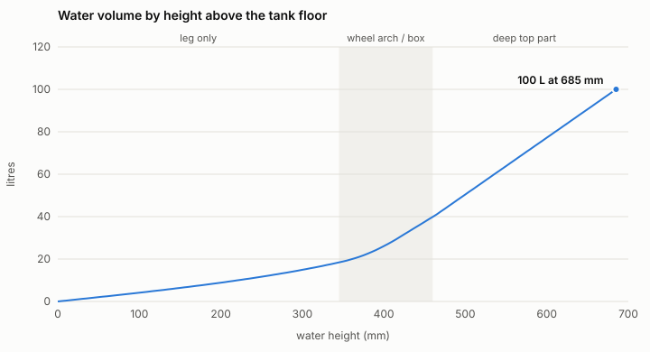
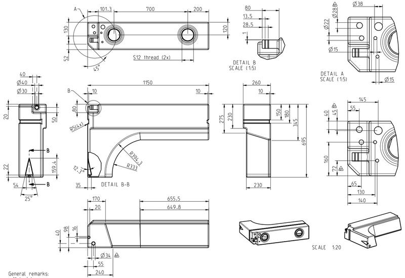

# Filling chart for the wheel-arch water tank

Calculated from the tank's technical drawing
([tank/tank-drawing.jpg](tank/tank-drawing.jpg)) with
[`tools/tank_wheelarch.py`](../tools/tank_wheelarch.py). **This table is already
the firmware's default**, so after `zero` on the empty tank the ESP32 shows
litres without any filling calibration.



**Capacity: 100 L**, the tank's nominal volume. The geometry alone gives
106 L (115 L from the outside dimensions, minus 5 mm walls), so the whole
curve is scaled by 0.94. That covers thicker walls, internal parts, and the
air space that stays under the top when the tank is filled to the brim of
the filler. Full (100 %) is at 685 mm water height.

## How the tank was modelled



| Part | Dimensions used (outside, mm) |
|---|---|
| Total height / length | 695 / 1150 |
| Depth | 260 in the top 230 mm, 230 below |
| Wheel arch | circle centred on the floor at 590 from the leg end; radius 420 on one face and 350 on the other (the arch is slanted across the depth) |
| Leg at the floor | 170 mm long on one face, 240 on the other (590 − 420 and 590 − 350, matching the bottom view) |
| Arch top / box bottom | 275 and 345 mm below the top (end view) |
| Walls | 5 mm (typical for roto-moulded PE) |

The drawing labels the arch curves R394.3 and R333. Those are the curved
wall surfaces, which aren't centred on the floor. The radius used here
(420 / 350 around a centre on the floor) is the one that matches the 170 /
240 mm leg and the 275 / 345 mm box bottom at the same time. The difference
in volume is below 1 L.

The volume is added up in 1 mm height slices, and each slice follows the arch
across the depth. Small details are ignored: the fittings, the V-shaped sump
under the outlet, rounded edges (R5) and the 10 mm chamfers. Together they
change the total by roughly 1–2 %.

## Where the sensor goes

The leg is the only part that reaches the floor, so the sensor must lie
**at the bottom of the leg**. Lower it through the threaded port above the
leg (the S12 port 101 mm from the leg end in the top view). The heights in the table are measured from the leg's inner floor.

Parking on a slope matters more for this tank than for a box. The upper
part is 1150 mm long, so when the van stands nose-up or nose-down, the water
shifts along it. Above about 350 mm (around 20 L) the reading is only exact
on level ground. The ESP32's slosh filter doesn't correct for a slope; park
level when you want a precise number.

## The table

| Height (mm) | Litres | % |
|---:|---:|---:|
| 0 | 0.0 | 0 |
| 20 | 0.8 | 1 |
| 40 | 1.6 | 2 |
| 60 | 2.4 | 2 |
| 80 | 3.3 | 3 |
| 100 | 4.1 | 4 |
| 120 | 5.0 | 5 |
| 140 | 5.9 | 6 |
| 160 | 6.9 | 7 |
| 180 | 7.8 | 8 |
| 200 | 8.9 | 9 |
| 220 | 9.9 | 10 |
| 240 | 11.1 | 11 |
| 260 | 12.3 | 12 |
| 280 | 13.6 | 14 |
| 300 | 14.9 | 15 |
| 320 | 16.4 | 16 |
| 340 | 18.0 | 18 |
| 350 | 18.9 | 19 |
| 360 | 19.9 | 20 |
| 380 | 22.5 | 23 |
| 400 | 26.1 | 26 |
| 420 | 30.5 | 30 |
| 440 | 35.2 | 35 |
| 460 | 39.9 | 40 |
| 465 | 41.1 | 41 |
| 480 | 45.1 | 45 |
| 500 | 50.4 | 50 |
| 520 | 55.8 | 56 |
| 540 | 61.2 | 61 |
| 560 | 66.5 | 67 |
| 580 | 71.9 | 72 |
| 600 | 77.2 | 77 |
| 620 | 82.6 | 83 |
| 640 | 87.9 | 88 |
| 660 | 93.3 | 93 |
| 680 | 98.7 | 99 |
| 685 | 100.0 | 100 |

## Checking it

1. Empty the tank, park level, type `zero` in the Serial Monitor.
2. Pour in 10 L and compare `litres=` in the log with the table. Repeat a few
   times. The bottom part (leg) is the most sensitive to the model, and the
   top part the least.
3. Best check: fill the empty tank completely and note how much went in
   (water meter, or count the buckets). If that isn't 100 L, rescale to the
   real number (below). If one region
   is off (e.g. around the arch), calibrate by filling in steps instead
   ([calibration.md](calibration.md), method A), which measures your real
   tank.

## Adjusting

```sh
python3 tools/tank_wheelarch.py                  # the default: scaled to 100 L
python3 tools/tank_wheelarch.py --capacity 95    # e.g. if it really holds 95 L
python3 tools/tank_wheelarch.py --capacity 0     # pure geometry (106 L)
```

Each prints `cal point ...` lines to paste into the Serial Monitor (followed
by `cal save`), plus the C table for `DEFAULT_TABLE` in the sketch.
`--markdown --svg docs/tank/tank-filling-chart.svg` regenerates this table
and the chart.
