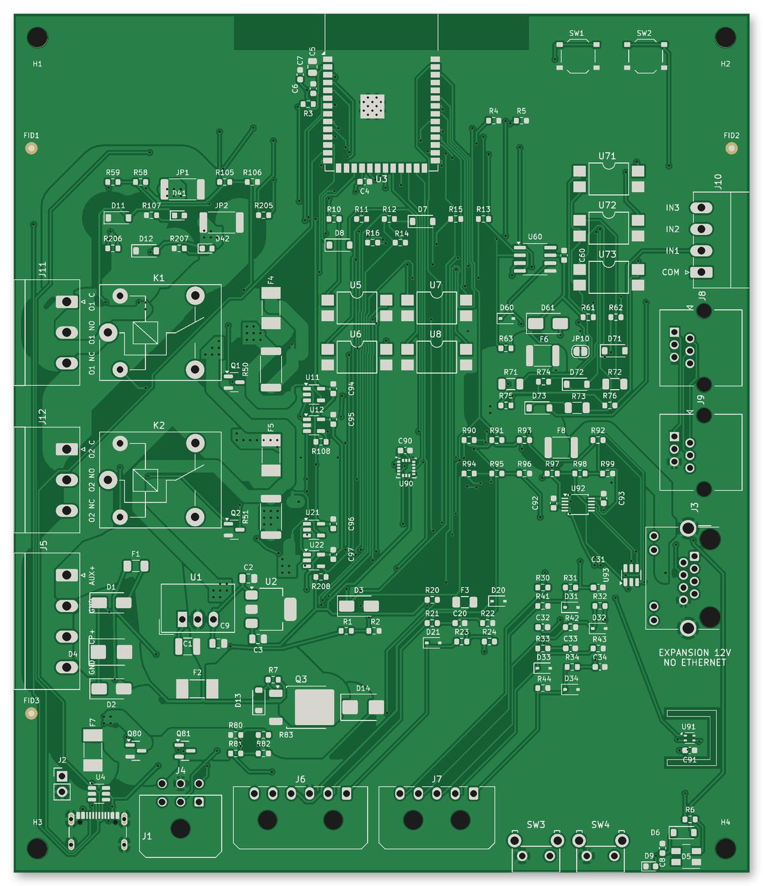
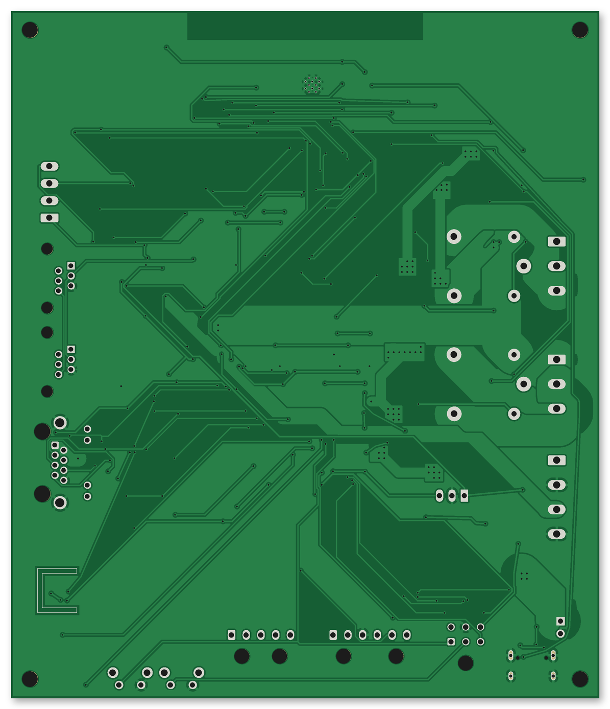

# I/O board – KiCad project (rev 0.4, routed, audited, JLCPCB parts – prototype)

KiCad 7 project for the board described in [docs/io-board.md](../../docs/io-board.md) and
[docs/io-board-schematic.md](../../docs/io-board-schematic.md). Open `io-board.kicad_pro` in
KiCad 7 or newer.

| File | What |
|---|---|
| `fab/io-board-gerbers.zip` | **Send this to the board maker:** Gerbers (2 layers, mask, paste, silkscreen, outline) and Excellon drill files (PTH and NPTH separate) |
| `fab/jlc/io-board-bom-jlc.csv`, `fab/jlc/io-board-cpl-jlc.csv` | **JLCPCB assembly files:** BOM with LCSC part numbers and placement list (164 parts; U92 not fitted), see "Ordering at JLCPCB" |
| `fab/io-board-pos.csv` | KiCad pick-and-place file (165 parts incl. U92, all on top; fiducials excluded) |
| `fab/io-board-bom.csv`, `io-board-bom.csv` | Parts list grouped by value and footprint (165 parts incl. U92; net ties, fiducials and the JP10 solder jumper are copper only) |
| `io-board.kicad_pcb` | Board 120 × 140 mm, 2 layers, **fully routed**: 0 unconnected, 0 DRC errors (see Checked) |
| `io-board.kicad_sch` | Schematic: 170 symbols (165 parts, the JP10 solder jumper, 4 net ties), grouped in 7 sections (power, ESP32, EBL, tanks, outputs, Truma + inputs, USB PD + sensors + expansion) |
| `io-board-schematic.pdf` | The schematic as PDF |
| `io-board.net` | Netlist exported by KiCad |
| `io-board.dsn` | The unrouted board for Freerouting (with the net classes) |
| `pcb-render-top.png`, `pcb-render-bottom.png` | Renders of the bare board as it comes from the fab (`sh tools/render.sh`) |
| `DESIGN-REVIEW.md` | Independent design audit: findings, calculations, what is and is not verified |
| `io_board.kicad_sym`, `sym-lib-table` | Project library with the PCA9615 symbol (not in the KiCad library) |
| `io_board.pretty`, `fp-lib-table` | Project footprints: RJ12 Connfly DS1133-S60 (6P6C), SK6812MINI-HS |
| `tools/` | Scripts: generate schematic and board from `parts.py`, rules, routing import, finishing, BOM, fab files |

**Order:** 2 layers, 1.6 mm FR-4, 1 oz (35 µm) copper, min. track/gap 0.15 mm, min. drill 0.3 mm,
any solder mask colour, **ENIG** finish (flat pads for the LGA-16, DFN-4 and 0.5 mm parts),
one internal routed slot (1 mm, around the SHT40).




## Checked

* **DRC (KiCad 7, with the KiCad libraries): 0 errors, 0 unconnected pads.** 38 warnings remain,
  all accepted: 31 × silkscreen past the board edge (the pluggable terminal blocks, RJ sockets,
  front-edge buttons and the ESP32 antenna overhang on purpose), 5 × the small J5 pin names touch
  the D1/D4 outline, 1 × silkscreen over a pad (removed in the Gerbers), 1 × ESP32 footprint
  differs from the library (thermal vias 0.3 mm, the 2-layer fab minimum).
* **Every pad carries the net `tools/parts.py` gives it** (525 pads compared), every footprint is
  linked to its schematic symbol, JLCPCB BOM and placement list agree (164 parts).
* KiCad reads the schematic and exports the netlist: 170 components, 120 named nets; the only
  one-pin nets are pins left open on purpose (spare ESP32 pins, sensor pins not used, SBU, LED DOUT).
* Electrical rules checked on KiCad's netlist: no two outputs on one net, every power input fed
  (power flags on GND, V12_SYS, V12_AUX, LIN_VBAT and the supplies).
* All footprints are linked to their symbols (Tools → Update PCB from Schematic works).
* No footprints overlap; all inside the outline (the ESP32 antenna keep-out sits at the back edge).
* Silkscreen: only small reference designators (placed so none overlaps a pad or another text),
  pin names next to every terminal block (J5: AUX+, GND, CP+, GND; J11: O1 C/NO/NC;
  J12: O2 C/NO/NC; J10: COM, IN1–IN3); part values are on the Fab layer only.
* KiCad 7's command line has no ERC: run **Inspect → Electrical Rules Checker** once in the GUI
  if you change the schematic.

## Before ordering

1. **Truma RJ12:** confirm pin 3 = LIN, pin 5 = GND with a meter; use a 1:1 cable.
2. **PCA9615 pinout:** checked against the NXP datasheet (Rev. 2, Table 3) and corrected (see below).
3. **Connector orientation:** all connectors open towards the edge they sit on (J5, J11, J12
   left; J8, J9, J3, J10 right; J1, J4, J6, J7 front). **J8/J9 (RJ12) use a footprint derived from
   KiCad's RJ14 Connfly DS1133** (6 contacts instead of 4): compare it with the Connfly drawing
   (LCSC C77859) – if the contact stagger were mirrored, LIN would arrive on pin 4.
4. **Front plate parts:** the 12 V ON/OFF buttons (Alps SKHHLQA010, right-angle, 8.35 mm stem,
   about 3 mm past the board edge) reach through holes in the front plate; the green "12 V on"
   LED (0603) and the RGB status LED sit at the edge and need light pipes in the plate.
5. **USB-C tablet charging:** a ready-made 12 V → USB-C PD 30 W module on J2 (its socket in the
   front plate), switched by Q80; no PD chip on this board.
6. **Tilt sensor:** order the **LIS3DH** (LGA-16 3 × 3, as on the board). The LIS2DH12 is LGA-12
   2 × 2 and does not fit this footprint.
7. **Stock:** JLCPCB stock was checked on 2026-11-28 (numbers in `tools/lcsc.py`); the BOM upload
   shows any line that ran out. U92 (PCA9615) is not fitted – solder it later for expansion boards.
8. **Plugs:** the pluggable terminal blocks need their plugs (not assembled): 1 × KF2EDGK-5.0-4P
   (C440871), 2 × KF2EDGK-5.0-3P (C440870), 1 × KF2EDGK-3.5-4P (C440849) – order from LCSC.
9. Order one prototype first.

## Ordering at JLCPCB

1. **PCB:** upload `fab/io-board-gerbers.zip`. 2 layers, 1.6 mm, 1 oz, **ENIG**, any colour; the
   board has one internal routed slot (SHT40) – JLCPCB detects it from the outline.
2. **Assembly:** "PCB Assembly", top side, **Standard** PCBA (the board has through-hole parts:
   relays, terminal blocks, RJ sockets, Micro-Fit, TSR-1, buttons). Upload
   `fab/jlc/io-board-bom-jlc.csv` and `fab/jlc/io-board-cpl-jlc.csv`.
3. **Check the placement preview** part by part, especially the rotation and pin 1 of: U3
   (ESP32), U90 (LIS3DH), U91 (SHT40), U60, U5–U8/U71–U73 (opto/photoMOS), D1–D4,
   D13, D14, D61, the LEDs and the RJ/USB connectors. The CPL uses KiCad's rotations; JLCPCB
   corrects them in the preview where their library differs.
4. Confirm the parts JLCPCB marks as "extended" (one-off fee per part type) and the through-hole
   parts (soldering fee).


## Checked against datasheets

Pinouts read from the manufacturers' datasheets (NXP PCA9615 Rev. 2, Diodes AP7361C, AOS AO3401A,
TI INA180 SBOS741H, Omron G5LE, SK6812MINI-E Rev. 02) and from KiCad's library symbols.

**Fixed:**

| Part | Problem | Fix |
|---|---|---|
| U92 PCA9615 | Pins 2–9 were wrong: pin 5 (VSS) was on +3.3 V, SDA/SCL/EN and the differential pins swapped | Pinout per Table 3: 1 VDD(A), 2 SDA, 3 EN, 4 SCL, 5 VSS, 6 DSCLM, 7 DSCLP, 8 DSDAP, 9 DSDAM, 10 VDD(B) |
| U2 AP7361C-33E | "-33E" is the SOT223 package; the board had a SOT-89-3 footprint (the SOT89 version has 5 pins) | Footprint SOT-223-3 (tab = GND) |
| Q80 AO3401A | Gate rated ±12 V, but Q81 pulled it to GND: VGS = −12…−14.6 V | R83 100 k in series: VGS = −V/2 (≈ −7 V), RDS(on) < 60 mΩ at −4.5 V |
| D5 status LED | Value SK6812MINI-E (3.2 × 2.8, pin 1 VDD, 4 DIN) on the SK6812MINI footprint and pinout (3.5 × 3.5, pin 4 VDD) | Value SK6812MINI, to match footprint and pinout |
| D5 data level | SK6812MINI: VIH 3.4 V at VDD 5 V (datasheet); the ESP32 drives 3.3 V | LED fed through D6 (1N4148W): VDD ≈ 4.3 V, VIH ≈ 2.9 V (scales with VDD) |
| D4 TVS | SMBJ24CA clamps at 38.9 V, above C1 (35 V) and the TSR-1 input (36 V) | SMBJ18A (stand-off 18 V, clamps 29.2 V), band to V12_SYS |
| R50/R51 shunts | 0.05 Ω at 5 A = 1.25 W; a standard 2512 is 1 W | Value "0.05 2W" (2 W or 3 W metal strip 2512) |
| U90 | BOM said LIS2DH12, which does not fit (see 6.) | Value LIS3DH |

**Verified, no change:** INA180A3 (pinout A: 1 OUT, 2 GND, 3 IN+, 4 IN−, 5 VS; common mode up to
26 V), G5LE-1 (coil 2–5, COM 1, NO 3, NC 4; 8 A at 30 VDC against 5 A used), TJA1021T, USBLC6-2SC6,
SHT40, LMV331, AO3400A, TSR 1-2450 (KiCad symbols). No mains voltage on the board: the EBL "mains"
wire is an ≈ 8 V indicator, so no high-voltage clearances are needed.

**Still for you to check (not possible from here):**

* **Stock:** see Before ordering, 7.
* **Pressure sensor:** the ADC input has no divider, so it is for the 0–3.3 V sensor (QDY30A). A
  0.5–4.5 V sensor needs a divider at R21/R22.
* **AO3401A turn-off:** R80/R83 make Q80 switch slowly (100 k); fine for the PD module, not for PWM.

## Rev 0.4: parts JLCPCB stocks

Every part is now one JLCPCB/LCSC stocks (2026-11-28); the substitutes and the fixes found
while reading their datasheets:

| Ref | Rev 0.3 | Rev 0.4 (LCSC) | Notes |
|---|---|---|---|
| K1, K2 | Omron G5LE-1 12 V (no stock) | Songle SRD-12VDC-SL-C (C30431) | 10 A 250 VAC / 28 VDC; same pin functions (1 COM, 2–5 coil, 3 NO, 4 NC), SRD footprint |
| J5 (10-way push-in) | Phoenix PT 1,5 | J5 4-way (AUX+, GND, CP+, GND), J11 / J12 3-way (output 1 / 2 C, NO, NC): pluggable KF2EDGR-5.0 (C441195, C441194) | 15 A; plugs ordered separately |
| J10 | Phoenix PT 1,5 3.5 mm | KF2EDGR-3.5-4P (C441173) | pluggable |
| J8, J9 | Amphenol RJ12 | Connfly DS1133-S60BPX (C77859) | footprint derived from KiCad's DS1133 RJ14 – check (Before ordering 3) |
| J3 | Amphenol RJ45 | Connfly DS1128-09-S8B8S (C77851) | shielded, shield to GND |
| F2, F4, F5, F7 | blade holder / 1812 fuses | Littelfuse Nano2 0451010/005/004 (C44479, C48467, C27515) | soldered SMD fuses, 125 V |
| SW1, SW2 | TL3342 | XKB TS-1187A-B-A-B (C318884, basic) | |
| SW3, SW4 | PTS645VL83 | Alps SKHHLQA010 (C125034) | right-angle, 8.35 mm stem |
| D9 | 3 mm right-angle LED | green 0603 (C12624) at the front edge | light pipe |
| D5 | SK6812MINI (no stock) | SK6812MINI-HS (C2922787) | **different pin positions** – own footprint from the OPSCO pad drawing |
| JP1, JP2 | 0 Ω 2512 | 1 mΩ 2 W 2512 (C2904226) | 44 A rated |
| C1 | 47 µF 35 V 1210 | 10 µF 50 V X7R 1210 (C138687) | |
| Q3 | IPD90P04P4L-04 (no stock) | AOS AOD4185 (C400894) | −40 V, 15 mΩ: 0.4 W at 5 A, 1.5 W at 10 A (RθJA 50 °C/W) |
| U92 | PCA9615 (no stock) | **not fitted** | termination and ESD stay; fit for expansion boards |
| **U5, U6** | AQY212EH on SO-4 footprint | **SMDIP-4** footprint | **error since rev 0.1:** the AQY212EH is a DIP4 part; its SMD version (EHAX, C29276) has gull-wing leads |

Also: pin names of the left terminal blocks turned 90° between the blocks and the relays;
`finish_routes.py` now routes wide nets first, never makes a pad stub narrower than the pad
allows, and respects pads' own clearances (fiducials).

## Rev 0.3: audit findings fixed

The independent audit ([DESIGN-REVIEW.md](DESIGN-REVIEW.md)) found three HIGH and six MEDIUM
issues in rev 0.2. All are resolved in rev 0.3 and re-measured on the routed board:

| Finding | Fix in rev 0.3 | Re-measured |
|---|---|---|
| H1 decoupling 15–109 mm from the pins, no bypass at INA180/LMV331 | Capacitors placed by a near-pin rule (`NEAR` in `pcb.py`); C9 (TSR-1 out), C94–C97 (INA180/LMV331) added | every decoupling cap 2.1–4.5 mm from its pin |
| H2 12 V AUX without reverse-polarity / transient protection | Q3 IPD90P04P4L-04 P-MOSFET (D13 12 V gate clamp, R7) after F2; D14 SMBJ15A on V12_AUX | reversed AUX: Q3 off; clamp 24.4 V < INA180 26 V, < 30 V MOSFETs |
| H3 front-plate controls behind the plugs | Right-angle buttons SW3/SW4 and LED D9 on the front edge, D5 at the edge with a light pipe; ST1–ST3 and USB-C packed to the left | actuators 5.5 mm, D9 lens 1.6 mm past the edge |
| M1 LMV331 input range at 3.3 V | U12/U22 on +5 V (VICR to 4.2 V), outputs still pulled to 3.3 V | – |
| M2 input resistors overloaded at 30 V | R71–R73 4.7 k **1206** (250 mW); inputs specified 9–30 V | 169 mW at 30 V |
| M3 input jumper spec | Spec corrected: 9–30 V = on, COM to GND by JP10, dry contacts from +12 V | – |
| M5 no ESD on the RJ45 lines | U93 ESDA6V1-5SC6 on DSDA±, DSCL±, EXP_INT | – |
| M6 HASL on fine pitch | Order ENIG | – |
| L1 no fiducials | FID1–FID3 (1 mm, excluded from pick-and-place) | – |
| L5 documents contradict the board | io-board.md and io-board-schematic.md updated | – |
| L6 no SHT40 slot | 1 mm U-shaped routed slot around the SHT40 island, keep-out on the slot | – |
| 5 A vias | Via clusters with copper squares at every 5 A layer change (`via_room.py`, `finish.py`) | 4–8 vias each |

Not changed: M4 (long USB lines – the USB-C must stay at the front edge and the ESP32 antenna at
the back; full-speed USB tolerates it), L2 (USB-C footprint hole spacing, same net), L3 (TSR-1
back-feed from USB: check the Traco datasheet), L4 (J5 GND must be wired – documented).

## Engineering review (rev 0.2)

Second full check: every pin against the manufacturer's datasheet, every net name, every
current path against its track, pour and vias. Datasheets read: NXP PCA9615 Rev. 2, NXP TJA1021
Rev. 9, ST LIS3DH Rev. 1, SK6812MINI Rev. 01, SK6812MINI-E Rev. 02, Diodes AP7361C, AOS AO3401A,
TI INA180 (SBOS741H), Omron G5LE.

**Found and fixed in rev 0.2:**

| # | Problem | Consequence | Fix |
|---|---|---|---|
| 1 | No termination / idle bias on the dI2C pairs (PCA9615 datasheet Fig. 5/7: R1-R2-R1 at each cable end) | The PCA9615 hot-swap logic only connects to a bus with valid termination: the expansion port would never work | R94–R99: 620 Ω to +5 V, 120 Ω across, 620 Ω to GND on DSCL and DSDA (100 Ω termination, D+ above D−). The expansion module needs the same network at its end |
| 2 | LIS3DH INT1 is push-pull only (CTRL_REG6 has polarity, no open-drain bit) and shared I2C_INT with the expansion INT line | An expansion module pulling INT low fights the sensor driving it high | Split: TILT_INT (LIS3DH → GPIO47), EXP_INT_MCU (RJ45 pin 7 via R92 100 Ω, 10 k pull-up R93 → GPIO40, open drain) |
| 3 | OUT1_C (JP1 → relay K1 COM, 5 A) changed layer through 2 vias of 0.3 mm (≈ 1.8 A each) | Via overheating at full load | 7 vias with copper squares on both layers; the other 5 A layer changes have 5–8 vias; V12_AUX 6–9 |
| 4 | TRUMA_12V and EXP_12V (1 A PTC, trips at ≈ 2 A) only as 0.3 mm tracks | Warm tracks before the PTC trips | Pours along both nets (up to 1.5 mm each side) |
| 5 | Fuse values without voltage rating | Wrong parts could be ordered | F1 0.5 A 30 V PTC, F3 50 mA 15 V PTC, F4/F5 5 A 32 V fast, F6/F8 1 A 30 V PTC, F7 4 A 32 V fast, F2 10 A mini blade |
| 6 | ESP32 module variant not pinned down | The -N8R8/-N16R8 use GPIO35–37 for octal PSRAM (EBL ON/OFF/12 V sense here) | Value note: ESP32-S3-WROOM-1-**N8** only |

**Checked, correct:**

* **Pinouts against the datasheets:** PCA9615 (Table 3), TJA1021 (1 RXD open drain with 10 k
  pull-up, 2 SLP_N with 100 k pull-down, 3 WAKE_N to VBAT through 10 k, 4 TXD, 5 GND, 6 LIN, 7 VBAT,
  8 INH open), LIS3DH (1 VDD_IO, 4 SCL, 6 SDA, 7 SA0 → GND = 0x18, 8 CS → 3.3 V = I2C, 10 RES → GND,
  11 INT1, 14 VDD), SK6812MINI (1 DOUT, 2 VSS, 3 DIN, 4 VDD), AP7361C-33E SOT223 (1 IN, 2/tab GND,
  3 OUT), INA180A3 pinout A, AO3400A/AO3401A (1 G, 2 S, 3 D), G5LE (coil 2–5, COM 1, NO 3, NC 4),
  USBLC6-2SC6, SHT40, TSR 1-2450, ESP32-S3-WROOM-1 (by pin name through KiCad's symbol; strapping
  GPIO0/3/45/46 not driven, USB D−/D+ on GPIO19/20, battery divider on ADC1).
* **Diode and LED polarity** (KiCad pin 1 = cathode = band/pad 1): D1/D2/D3/D61 series diodes,
  D4 SMBJ18A band to V12_SYS, flyback D11/D12 cathode to +12 V, input diodes D71–D73, zeners
  D7/D8 reverse biased, LEDs D9/D41/D42 anode to the resistor.
* **Operating points:** relay drive 3.3 V on AO3400A (VGS(th) ≤ 1.45 V); photoMOS LED 6 mA
  (AQY212EH needs ≤ 3 mA); EBL "12 V on" opto 1.3 mA at 12 V, "mains" opto 2 mA at 8 V;
  inputs 2.1 mA; battery divider 15 V → 2.7 V; Output "on" threshold 0.148 V / (100 × 0.05 Ω)
  = 30 mA; Q80 VGS ≈ −7 V with R80/R83; USB-C CC 5.1 k on both.
* **Net names** say what the net is (OUT1_C/NO/NC, SH1_P/N + Kelvin SH1_SP/SN, EBL_ON/OFF,
  TILT_INT, EXP_INT_MCU, …); no net is left with a name that does not match its function.
* **Every pad on the board carries the net parts.py gives it** (500 pads compared), every
  footprint is linked to its schematic symbol.
* **Current paths:** all 5–10 A nets are 2 mm tracks (only short neck-downs at small pads), with
  pours where there is room; R50 → JP1 runs on one layer; GND is connected by tracks alone and
  additionally poured on both layers.

**Not changed, worth knowing:**

* USB D+/D− are long (≈ 160–175 mm, 2–4 vias): fine for 12 Mbit/s full speed, keep the
  programming cable short.
* SK6812MINI data at 3.3 V against VIH ≈ 2.9 V (VDD 4.3 V): about 0.4 V margin.
* The expansion module must carry the same 620/120/620 Ω network at its PCA9615.

## Layout and routing

| Class | Track | Clearance | Nets |
|---|---|---|---|
| HighCurrent | 2.0 mm | 0.3 mm | 12 V AUX, both outputs (C/NO/NC, shunts, fuses, JP1/JP2), USB PD supply |
| Power | 0.3 mm | 0.15 mm | 12 V system, +5 V, +3.3 V, GND, LIN supply, sensor and CP plus 12 V, relay coils |
| Default | 0.25 mm | 0.15 mm | all signals, the INA180 sense lines |

* **12 V AUX (F2, 10 A):** reverse-polarity MOSFET Q3 and TVS D14 after the fuse; besides the 2 mm tracks, copper pours along every V12_AUX track
  (up to 3 mm each side, both layers) carry the trunk from F2 to the output fuses, F7 and relays.
* **Current sense:** the INA180s measure the shunts through net ties (Kelvin taps NT11–NT22), so
  the 5 A current does not flow in their sense lines.
* **GND:** routed as a net (tracks and vias) and in addition a copper pour on both layers; small
  pads connect solidly, through-hole pads with thermal spokes. The ESP32 antenna end has no copper.
* **Heat:** U2 (SOT223) sits with its tab in the GND pour; R50/R51 and Q80 have 2 mm tracks on both
  pads; the relays and fuses have the V12_AUX pours.
* **Silkscreen:** "EXPANSION 12V / NO ETHERNET" at the RJ45 (pins 1–2 carry 12 V).
* The clearances are 0.15 mm so tracks reach the 0.5 mm pitch pins (LIS3DH, PCA9615, USB-C);
  for 12 V a gap of 0.1 mm is enough (IPC-2221). The hole clearance is 0.19 mm because the USB-C
  footprint (GCT USB4105) has its pegs 0.194 mm from its GND pads.

How the board was routed (to repeat after changes, with KiCad 7's Python and Freerouting 1.9.0;
Freerouting needs a display, e.g. `xvfb-run`):

1. `python3 tools/pcb.py && python3 tools/rules.py && python3 tools/zones.py` (in a scratch folder
   with `io-board.kicad_pro`, see Regenerating), then remove from `io-board.dsn` the `(plane GND …)`
   entries (GND is routed as a net) and the `(keepout "" (polygon signal …))` that KiCad writes for
   the SHT40 slot (it covers the whole island; the slot arms have their own keep-outs).
2. `java -jar freerouting-1.9.0.jar -de io-board.dsn -do io-board.ses -mp 100`
3. `python3 tools/import_ses.py io-board.kicad_pcb io-board.ses drc.rpt` (KiCad 7 imports .ses only
   in the GUI; this does it with the API).
4. Netlist changes after routing: edit `tools/parts.py`, then `python3 tools/apply_netlist.py`
   (regenerates the schematic, links footprints, sets pad nets, places new parts on free area).
   `python3 tools/move_near.py io-board.kicad_pcb REF:IC:PIN …` moves a part next to a pin on the
   routed board. `python3 tools/via_room.py io-board.kicad_pcb NET:x:y …` clears room for a via
   cluster at a crowded 5 A layer change. `python3 tools/stubs.py io-board.kicad_pcb` (exit tracks for the SHT40 pads past its keep-out),
   then `python3 tools/finish_routes.py io-board.kicad_pcb` routes whatever Freerouting left
   (grid A* with the net-class clearances) and removes dangling stubs.
5. `python3 tools/finish.py io-board.kicad_pcb`: pours on the 5–10 A and 1 A nets, via clusters,
   JP10 off the plane, fiducials out of the pick-and-place, footprint library names, RJ45 warning
   text, reference texts off other silkscreen, no copper islands, zones refilled.
6. `sh tools/fab.sh` writes `fab/`, `sh tools/render.sh` the renders.

## Regenerating

The schematic and the board are generated from `tools/parts.py`: change the netlist there and
run, with KiCad 7's Python (`pcbnew` module):

```
cd hardware/io-board/tools && python3 pcb.py && python3 rules.py && python3 zones.py
```

It writes `io-board.kicad_sch` and `io-board.kicad_pcb` into the current folder. Once routing
has started in KiCad, edit the KiCad files directly instead.
