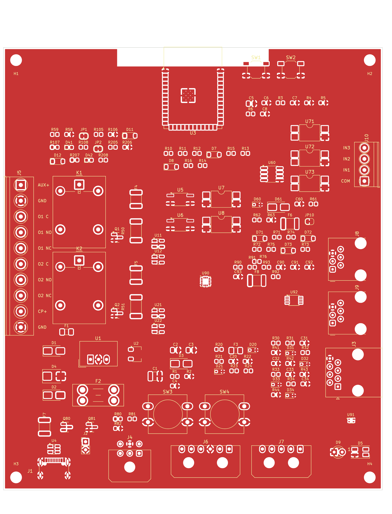

# I/O board – KiCad project (rev 0.1, planning)

KiCad 7 project for the board described in [docs/io-board.md](../../docs/io-board.md) and
[docs/io-board-schematic.md](../../docs/io-board-schematic.md). Open `io-board.kicad_pro` in
KiCad 7 or newer.

| File | What |
|---|---|
| `io-board.kicad_sch` | Schematic: 148 parts, every part with a real library symbol and footprint, connected by net labels, grouped in 7 sections (power, ESP32, EBL, tanks, outputs, Truma + inputs, USB PD + sensors + expansion) |
| `io-board.kicad_pcb` | Board 120 × 140 mm with all footprints placed as in the placement plan, nets assigned (ratsnest shown), 4 × M3 holes, GND planes on both layers. **Tracks not routed yet** |
| `io-board.dsn` | The board exported for the Freerouting autorouter (with the net classes) |
| `io-board-schematic.pdf` | The schematic as PDF |
| `io-board-bom.csv` | Parts list grouped by value and footprint |
| `io-board.net` | Netlist exported by KiCad |
| `pcb-placement.png` | Preview of the placement |
| `io_board.kicad_sym`, `sym-lib-table` | Project library with the PCA9615 symbol (not in the KiCad library) |
| `tools/` | The scripts that generate the schematic and the board from `parts.py` (the netlist in plain Python) |



## Checked

* KiCad reads the schematic and exports the netlist: 148 components, 113 named nets; the only
  one-pin nets are pins left open on purpose (spare ESP32 pins, sensor pins not used, SBU, LED DOUT).
* Electrical rules checked on KiCad's netlist: no two outputs on one net, every power input fed
  (power flags on GND, V12_SYS, V12_AUX, LIN_VBAT and the supplies).
* All 148 footprints are linked to their symbols (Tools → Update PCB from Schematic works).
* No footprints overlap; all inside the outline (the ESP32 antenna keep-out sits at the back edge).
* Silkscreen: only small reference designators (placed so none overlaps a pad or another text),
  pin names next to every push-in terminal (J5: AUX+, GND, O1 C/NO/NC, O2 C/NO/NC, CP+, GND;
  J10: COM, IN1–IN3); part values are on the Fab layer only.
* KiCad 7's command line has no ERC/DRC: run **Inspect → Electrical Rules Checker** and, after
  routing, the DRC in the KiCad GUI.

## Before ordering

1. **Truma RJ12:** confirm pin 3 = LIN, pin 5 = GND with a meter; use a 1:1 cable.
2. **PCA9615 pinout:** checked against the NXP datasheet (Rev. 2, Table 3) and corrected (see below).
3. **Connector orientation:** checked on the board: all nine connectors open towards the edge they
   sit on (J5 left; J8, J9, J3, J10 right; J1, J4, J6, J7 front). Hold the real parts against a
   1:1 print before ordering.
4. **Front plate parts:** the 12 V ON/OFF buttons (12 mm), the "12 V on" LED and the status LED
   are on the board's front edge here; if they sit in the front plate instead, put them on a
   small cable or a second board.
5. **USB-C tablet charging:** a ready-made 12 V → USB-C PD 30 W module on J2 (its socket in the
   front plate), switched by Q80; no PD chip on this board.
6. **Tilt sensor:** order the **LIS3DH** (LGA-16 3 × 3, as on the board). The LIS2DH12 is LGA-12
   2 × 2 and does not fit this footprint.
7. **Routing:** 2 layers, ground pour on both sides; wide tracks (≥ 2 mm, or copper pours) for
   12 V AUX, the outputs and the relay contacts (5 A); keep the antenna end free of copper.
8. Then DRC, gerbers, one prototype.

## Checked against datasheets

Pinouts read from the manufacturers' datasheets (NXP PCA9615 Rev. 2, Diodes AP7361C, AOS AO3401A,
TI INA180 SBOS741H, Omron G5LE, SK6812MINI-E Rev. 02) and from KiCad's library symbols.

**Fixed:**

| Part | Problem | Fix |
|---|---|---|
| U92 PCA9615 | Pins 2–9 were wrong: pin 5 (VSS) was on +3.3 V, SDA/SCL/EN and the differential pins swapped | Pinout per Table 3: 1 VDD(A), 2 SDA, 3 EN, 4 SCL, 5 VSS, 6 DSCLM, 7 DSCLP, 8 DSDAP, 9 DSDAM, 10 VDD(B) |
| U2 AP7361C-33E | "-33E" is the SOT223 package; the board had a SOT-89-3 footprint (the SOT89 version has 5 pins) | Footprint SOT-223-3 (tab = GND) |
| Q80 AO3401A | Gate rated ±12 V, but Q81 pulled it to GND: VGS = −12…−14.6 V | R83 100 k in series: VGS = −V/2 (≈ −7 V), RDS(on) < 60 mΩ at −4.5 V |
| D5 status LED | Value SK6812MINI-E (3.2 × 2.8, pin 1 VDD, 4 DIN) on the SK6812MINI footprint and pinout (3.5 × 3.5, pin 4 VDD) | Value SK6812MINI, to match footprint and pinout |
| D5 data level | VIH = 0.7 × VDD = 3.5 V at 5 V; the ESP32 drives 3.3 V | LED fed through D6 (1N4148W): VDD ≈ 4.3 V, VIH ≈ 3.0 V |
| D4 TVS | SMBJ24CA clamps at 38.9 V, above C1 (35 V) and the TSR-1 input (36 V) | SMBJ18A (stand-off 18 V, clamps 29.2 V), band to V12_SYS |
| R50/R51 shunts | 0.05 Ω at 5 A = 1.25 W; a standard 2512 is 1 W | Value "0.05 2W" (2 W or 3 W metal strip 2512) |
| U90 | BOM said LIS2DH12, which does not fit (see 6.) | Value LIS3DH |

**Verified, no change:** INA180A3 (pinout A: 1 OUT, 2 GND, 3 IN+, 4 IN−, 5 VS; common mode up to
26 V), G5LE-1 (coil 2–5, COM 1, NO 3, NC 4; 8 A at 30 VDC against 5 A used), TJA1021T, USBLC6-2SC6,
SHT40, LMV331, AO3400A, TSR 1-2450 (KiCad symbols). No mains voltage on the board: the EBL "mains"
wire is an ≈ 8 V indicator, so no high-voltage clearances are needed.

**Still for you to check (not possible from here):**

* **Stock:** check every line of the BOM at the distributor before ordering, especially PCA9615DP,
  LIS3DH, AQY212EH, TSR 1-2450 and the 2 W shunts.
* **12 V AUX current:** F2 is 10 A, but a 2 mm track on 35 µm copper carries ≈ 5–7 A at 10–20 °C rise.
  Order **2 oz (70 µm) copper**, or add a V12_AUX copper pour from F2 to the relays, fuses and Q80.
* **Heat:** R50/R51 (1.25 W each at 5 A), Q80 (≈ 0.4 W at 2.5 A) and U2 (up to ≈ 0.8 W) need copper
  around their pads; look at them in the routed board.
* **Pressure sensor:** the ADC input has no divider, so it is for the 0–3.3 V sensor (QDY30A). A
  0.5–4.5 V sensor needs a divider at R21/R22.
* **RJ45 expansion:** pins 1–2 carry 12 V, so mark the socket so no Ethernet cable is plugged in.
* **AO3401A turn-off:** R80/R83 make Q80 switch slowly (100 k); fine for the PD module, not for PWM.

## Routing (next step)

Design rules are in the project (net classes):

| Class | Track | Clearance | Nets |
|---|---|---|---|
| HighCurrent | 2.0 mm | 0.3 mm | 12 V AUX, both outputs (C/NO/NC, shunts, fuses), USB PD supply |
| Power | 0.4 mm | 0.15 mm | 12 V system, +5 V, +3.3 V, GND, LIN supply, sensor and CP plus 12 V, relay coils |
| Default | 0.25 mm | 0.15 mm | all signals |

GND is a copper plane on both layers (the ESP32 antenna end stays free of copper).

The clearances are 0.15 mm so tracks can reach the 0.5 mm pitch pins (LIS2DH12, PCA9615, USB-C);
for 12 V a gap of 0.1 mm is enough (IPC-2221). With 0.25 mm and 0.6 mm Power tracks, Freerouting
left every pin on those parts unconnected.

To route with **Freerouting** (free):

1. Install Java 17+ and download `freerouting-1.9.0.jar` from github.com/freerouting/freerouting.
2. `java -jar freerouting-1.9.0.jar -de io-board.dsn -do io-board.ses -mp 30`
   (or open the .dsn in its window and press *Autorouter*).
3. KiCad PCB editor: *File → Import → Specctra Session* → `io-board.ses`.
4. *Edit → Fill All Zones* (B), then *Inspect → Design Rules Checker*; fix what it reports.
5. Check by eye: the 2 mm tracks for the outputs, short tracks around the 5 V/3.3 V parts,
   the LIN line and USB lines kept short.

KiCad's own interactive router (X key) works just as well for hand-routing, starting with the
HighCurrent nets.

## Regenerating

The schematic and the board are generated from `tools/parts.py`: change the netlist there and
run, with KiCad 7's Python (`pcbnew` module):

```
cd hardware/io-board/tools && python3 pcb.py && python3 rules.py && python3 zones.py
```

It writes `io-board.kicad_sch` and `io-board.kicad_pcb` into the current folder. Once routing
has started in KiCad, edit the KiCad files directly instead.
