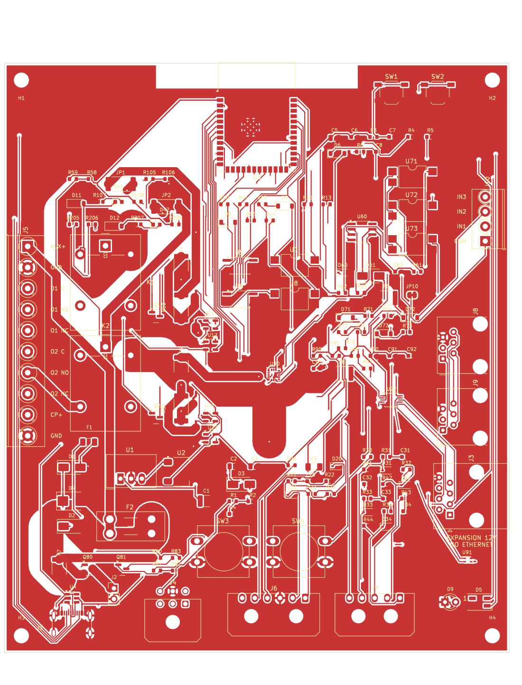
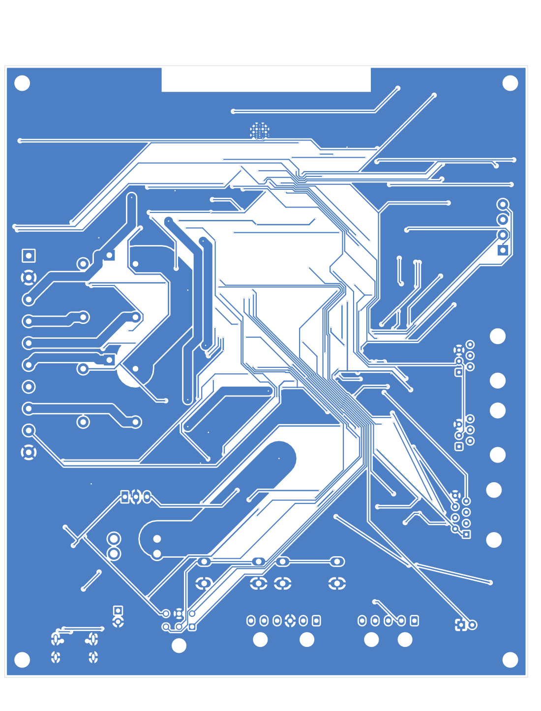

# I/O board – KiCad project (rev 0.1, routed, ready to order)

KiCad 7 project for the board described in [docs/io-board.md](../../docs/io-board.md) and
[docs/io-board-schematic.md](../../docs/io-board-schematic.md). Open `io-board.kicad_pro` in
KiCad 7 or newer.

| File | What |
|---|---|
| `fab/io-board-gerbers.zip` | **Send this to the board maker:** Gerbers (2 layers, mask, paste, silkscreen, outline) and Excellon drill files (PTH and NPTH separate) |
| `fab/io-board-pos.csv` | Pick-and-place file (147 parts, all on top) for assembly |
| `fab/io-board-bom.csv`, `io-board-bom.csv` | Parts list grouped by value and footprint (147 parts; net ties and the JP10 solder jumper are copper only) |
| `io-board.kicad_pcb` | Board 120 × 140 mm, 2 layers, **fully routed**: 0 unconnected, 0 DRC errors (see Checked) |
| `io-board.kicad_sch` | Schematic: 152 symbols (148 parts + 4 net ties), grouped in 7 sections (power, ESP32, EBL, tanks, outputs, Truma + inputs, USB PD + sensors + expansion) |
| `io-board-schematic.pdf` | The schematic as PDF |
| `io-board.net` | Netlist exported by KiCad |
| `io-board.dsn` | The unrouted board for Freerouting (with the net classes) |
| `pcb-front.png`, `pcb-back.png` | Copper previews of both layers |
| `pcb-placement.png` | Preview of the placement (before routing) |
| `io_board.kicad_sym`, `sym-lib-table` | Project library with the PCA9615 symbol (not in the KiCad library) |
| `tools/` | Scripts: generate schematic and board from `parts.py`, rules, routing import, finishing, BOM, fab files |

**Order:** 2 layers, 1.6 mm FR-4, 1 oz (35 µm) copper, min. track/gap 0.15 mm, min. drill 0.3 mm,
any solder mask colour, HASL or ENIG.




## Checked

* **DRC (KiCad 7, with the KiCad libraries): 0 errors, 0 unconnected pads.** 18 warnings remain,
  all accepted: 12 × silkscreen of the 12 mm buttons over their pads (removed in the Gerbers,
  which subtract the solder mask), 5 × silkscreen of J3/J8/J9 and the ESP32 antenna past the
  board edge (these parts overhang on purpose), 1 × ESP32 footprint differs from the library
  (its thermal vias are 0.3 mm instead of 0.2 mm, the 2-layer fab minimum).
* KiCad reads the schematic and exports the netlist: 152 components, 117 named nets; the only
  one-pin nets are pins left open on purpose (spare ESP32 pins, sensor pins not used, SBU, LED DOUT).
* Electrical rules checked on KiCad's netlist: no two outputs on one net, every power input fed
  (power flags on GND, V12_SYS, V12_AUX, LIN_VBAT and the supplies).
* All footprints are linked to their symbols (Tools → Update PCB from Schematic works).
* No footprints overlap; all inside the outline (the ESP32 antenna keep-out sits at the back edge).
* Silkscreen: only small reference designators (placed so none overlaps a pad or another text),
  pin names next to every push-in terminal (J5: AUX+, GND, O1 C/NO/NC, O2 C/NO/NC, CP+, GND;
  J10: COM, IN1–IN3); part values are on the Fab layer only.
* KiCad 7's command line has no ERC: run **Inspect → Electrical Rules Checker** once in the GUI
  if you change the schematic.

## Before ordering

1. **Truma RJ12:** confirm pin 3 = LIN, pin 5 = GND with a meter; use a 1:1 cable.
2. **PCA9615 pinout:** checked against the NXP datasheet (Rev. 2, Table 3) and corrected (see below).
3. **Connector orientation:** checked on the board: all nine connectors open towards the edge they
   sit on (J5 left; J8, J9, J3, J10 right; J1, J4, J6, J7 front). Hold the real parts against a
   1:1 print before ordering.
4. **Front plate parts:** the 12 V ON/OFF buttons (12 mm), the "12 V on" LED and the status LED
   are on the board's front edge here; if they sit in the front plate instead, put them on a
   small cable or a second board.
5. **USB-C tablet charging:** a ready-made 12 V → USB-C PD 30 W module on J2 (its socket in the
   front plate), switched by Q80; no PD chip on this board.
6. **Tilt sensor:** order the **LIS3DH** (LGA-16 3 × 3, as on the board). The LIS2DH12 is LGA-12
   2 × 2 and does not fit this footprint.
7. **Stock:** check every BOM line at the distributor, especially PCA9615DP, LIS3DH, AQY212EH,
   TSR 1-2450, the 2 W shunts and the 0 Ω 2512 links (JP1/JP2, rated ≥ 6 A).
8. Order one prototype first.

## Checked against datasheets

Pinouts read from the manufacturers' datasheets (NXP PCA9615 Rev. 2, Diodes AP7361C, AOS AO3401A,
TI INA180 SBOS741H, Omron G5LE, SK6812MINI-E Rev. 02) and from KiCad's library symbols.

**Fixed:**

| Part | Problem | Fix |
|---|---|---|
| U92 PCA9615 | Pins 2–9 were wrong: pin 5 (VSS) was on +3.3 V, SDA/SCL/EN and the differential pins swapped | Pinout per Table 3: 1 VDD(A), 2 SDA, 3 EN, 4 SCL, 5 VSS, 6 DSCLM, 7 DSCLP, 8 DSDAP, 9 DSDAM, 10 VDD(B) |
| U2 AP7361C-33E | "-33E" is the SOT223 package; the board had a SOT-89-3 footprint (the SOT89 version has 5 pins) | Footprint SOT-223-3 (tab = GND) |
| Q80 AO3401A | Gate rated ±12 V, but Q81 pulled it to GND: VGS = −12…−14.6 V | R83 100 k in series: VGS = −V/2 (≈ −7 V), RDS(on) < 60 mΩ at −4.5 V |
| D5 status LED | Value SK6812MINI-E (3.2 × 2.8, pin 1 VDD, 4 DIN) on the SK6812MINI footprint and pinout (3.5 × 3.5, pin 4 VDD) | Value SK6812MINI, to match footprint and pinout |
| D5 data level | VIH = 0.7 × VDD = 3.5 V at 5 V; the ESP32 drives 3.3 V | LED fed through D6 (1N4148W): VDD ≈ 4.3 V, VIH ≈ 3.0 V |
| D4 TVS | SMBJ24CA clamps at 38.9 V, above C1 (35 V) and the TSR-1 input (36 V) | SMBJ18A (stand-off 18 V, clamps 29.2 V), band to V12_SYS |
| R50/R51 shunts | 0.05 Ω at 5 A = 1.25 W; a standard 2512 is 1 W | Value "0.05 2W" (2 W or 3 W metal strip 2512) |
| U90 | BOM said LIS2DH12, which does not fit (see 6.) | Value LIS3DH |

**Verified, no change:** INA180A3 (pinout A: 1 OUT, 2 GND, 3 IN+, 4 IN−, 5 VS; common mode up to
26 V), G5LE-1 (coil 2–5, COM 1, NO 3, NC 4; 8 A at 30 VDC against 5 A used), TJA1021T, USBLC6-2SC6,
SHT40, LMV331, AO3400A, TSR 1-2450 (KiCad symbols). No mains voltage on the board: the EBL "mains"
wire is an ≈ 8 V indicator, so no high-voltage clearances are needed.

**Still for you to check (not possible from here):**

* **Stock:** see Before ordering, 7.
* **Pressure sensor:** the ADC input has no divider, so it is for the 0–3.3 V sensor (QDY30A). A
  0.5–4.5 V sensor needs a divider at R21/R22.
* **AO3401A turn-off:** R80/R83 make Q80 switch slowly (100 k); fine for the PD module, not for PWM.

## Layout and routing

| Class | Track | Clearance | Nets |
|---|---|---|---|
| HighCurrent | 2.0 mm | 0.3 mm | 12 V AUX, both outputs (C/NO/NC, shunts, fuses, JP1/JP2), USB PD supply |
| Power | 0.3 mm | 0.15 mm | 12 V system, +5 V, +3.3 V, GND, LIN supply, sensor and CP plus 12 V, relay coils |
| Default | 0.25 mm | 0.15 mm | all signals, the INA180 sense lines |

* **12 V AUX (F2, 10 A):** besides the 2 mm tracks, copper pours along every V12_AUX track
  (up to 3 mm each side, both layers) carry the trunk from F2 to the output fuses, F7 and relays.
* **Current sense:** the INA180s measure the shunts through net ties (Kelvin taps NT11–NT22), so
  the 5 A current does not flow in their sense lines.
* **GND:** routed as a net (tracks and vias) and in addition a copper pour on both layers; small
  pads connect solidly, through-hole pads with thermal spokes. The ESP32 antenna end has no copper.
* **Heat:** U2 (SOT223) sits with its tab in the GND pour; R50/R51 and Q80 have 2 mm tracks on both
  pads; the relays and fuses have the V12_AUX pours.
* **Silkscreen:** "EXPANSION 12V / NO ETHERNET" at the RJ45 (pins 1–2 carry 12 V).
* The clearances are 0.15 mm so tracks reach the 0.5 mm pitch pins (LIS3DH, PCA9615, USB-C);
  for 12 V a gap of 0.1 mm is enough (IPC-2221). The hole clearance is 0.19 mm because the USB-C
  footprint (GCT USB4105) has its pegs 0.194 mm from its GND pads.

How the board was routed (to repeat after changes, with KiCad 7's Python and Freerouting 1.9.0;
Freerouting needs a display, e.g. `xvfb-run`):

1. `python3 tools/pcb.py && python3 tools/rules.py && python3 tools/zones.py` (in a scratch folder
   with `io-board.kicad_pro`, see Regenerating), then remove the `(plane GND …)` entries from
   `io-board.dsn` so GND is routed as a net.
2. `java -jar freerouting-1.9.0.jar -de io-board.dsn -do io-board.ses -mp 100`
3. `python3 tools/import_ses.py io-board.kicad_pcb io-board.ses drc.rpt` (KiCad 7 imports .ses only
   in the GUI; this does it with the API).
4. `python3 tools/stubs.py io-board.kicad_pcb` (exit tracks for the SHT40 pads past its keep-out),
   then `python3 tools/finish_routes.py io-board.kicad_pcb` routes whatever Freerouting left
   (grid A* with the net-class clearances) and removes dangling stubs.
5. `python3 tools/finish.py io-board.kicad_pcb`: V12_AUX pours, JP10 off the plane, footprint library
   names, RJ45 warning text, reference texts off other silkscreen, zones refilled.
6. `sh tools/fab.sh` writes `fab/`.

## Regenerating

The schematic and the board are generated from `tools/parts.py`: change the netlist there and
run, with KiCad 7's Python (`pcbnew` module):

```
cd hardware/io-board/tools && python3 pcb.py && python3 rules.py && python3 zones.py
```

It writes `io-board.kicad_sch` and `io-board.kicad_pcb` into the current folder. Once routing
has started in KiCad, edit the KiCad files directly instead.
